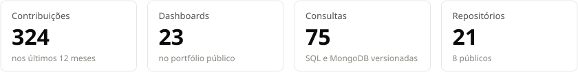
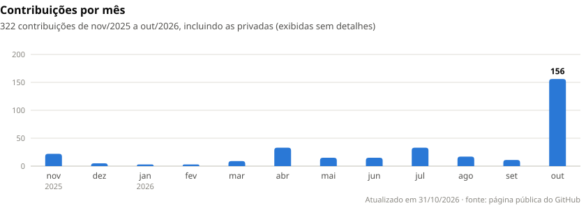
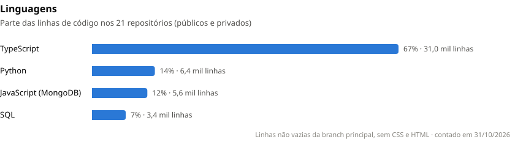
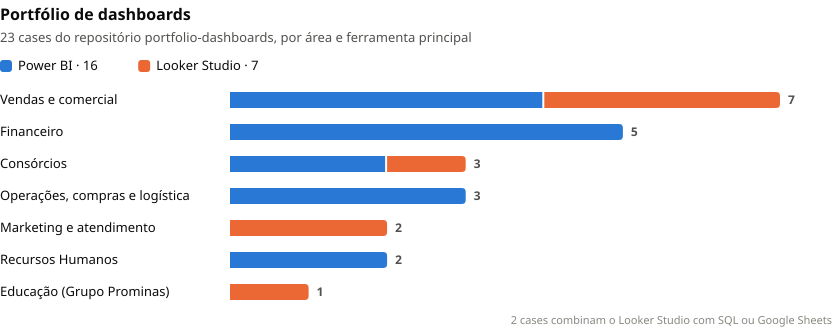

## Olá! 👋

Sou o **Ítalo Marques**, Analista de Dados no **Grupo Prominas**, apaixonado por transformar dados em insights estratégicos. 🚀

- 🔭 Focado em projetos de análise de dados e otimização de negócios.
- 🌱 Aprendendo todos os dias sobre extração, tratamento e visualização de dados.
- 💬 Pergunte-me sobre SQL, visualização de dados e dicas de análise de dados.
- 🎨 Portfólio: [italomarquesc.my.canva.site](https://italomarquesc.my.canva.site) · 🌐 Site: [marquesbi.com.br](https://marquesbi.com.br)

Vamos simplificar dados juntos!

## 🧰 Ferramentas

<picture>
  <source media="(prefers-color-scheme: dark)" srcset="https://skillicons.dev/icons?i=py%2Cmysql%2Cpostgres%2Cmongodb%2Cts%2Cjs%2Creact%2Cnextjs%2Cnodejs%2Cfastapi%2Cdocker%2Cgit%2Cgithubactions%2Cpostman&theme=dark">
  
</picture>

| Área | Ferramentas |
|---|---|
| Análise e BI | Power BI · Looker Studio · Excel · Google Sheets |
| Bancos e consultas | SQL (MySQL e PostgreSQL) · MongoDB |
| Programação | Python (pandas) · TypeScript · JavaScript |
| Desenvolvimento | React · Next.js · Node.js · FastAPI · Docker · Git · GitHub Actions · Postman |

## 📊 Em números

<picture>
  <source media="(prefers-color-scheme: dark)" srcset="graficos/numeros-escuro.svg">
  
</picture>

<picture>
  <source media="(prefers-color-scheme: dark)" srcset="graficos/contribuicoes-escuro.svg">
  
</picture>

<picture>
  <source media="(prefers-color-scheme: dark)" srcset="graficos/linguagens-escuro.svg">
  
</picture>

<picture>
  <source media="(prefers-color-scheme: dark)" srcset="graficos/portfolio-escuro.svg">
  
</picture>

Ver os dados dos gráficos

**Contribuições por mês** (atualizado toda semana)

<!-- contribuicoes:inicio -->
| Mês | Contribuições |
|---|---:|
| nov/2025 | 22 |
| dez/2025 | 5 |
| jan/2026 | 3 |
| fev/2026 | 3 |
| mar/2026 | 9 |
| abr/2026 | 33 |
| mai/2026 | 15 |
| jun/2026 | 15 |
| jul/2026 | 33 |
| ago/2026 | 17 |
| set/2026 | 11 |
| out/2026 | 158 |
| **Total** | **324** |
<!-- contribuicoes:fim -->

**Linguagens** (linhas não vazias da branch principal dos 21 repositórios, sem CSS e HTML, contado em 31/10/2026)

| Linguagem | Linhas | Parte |
|---|---:|---:|
| TypeScript | 31.019 | 67% |
| Python | 6.364 | 14% |
| JavaScript (MongoDB) | 5.599 | 12% |
| SQL | 3.420 | 7% |

**Portfólio de dashboards** (ferramenta principal de cada case)

| Área | Power BI | Looker Studio | Total |
|---|---:|---:|---:|
| Vendas e comercial | 4 | 3 | 7 |
| Financeiro | 5 | 0 | 5 |
| Consórcios | 2 | 1 | 3 |
| Operações, compras e logística | 3 | 0 | 3 |
| Marketing e atendimento | 0 | 2 | 2 |
| Recursos Humanos | 2 | 0 | 2 |
| Educação (Grupo Prominas) | 0 | 1 | 1 |
| **Total** | **16** | **7** | **23** |

Os gráficos são gerados por <a href="scripts/gerar_graficos.py">scripts/gerar_graficos.py</a>. As contribuições são atualizadas toda segunda-feira pelo GitHub Actions; os outros números vêm de <a href="graficos/dados.json">graficos/dados.json</a>.

## 📂 Projetos em destaque

| Projeto | Descrição |
|---|---|
| [portfolio-dashboards](https://github.com/ItaloHenriqueMarquesCampos/portfolio-dashboards) | 23 cases de dashboards em Power BI, Looker Studio e Google Sheets, organizados por área |
| [sorteador-uniunica](https://github.com/ItaloHenriqueMarquesCampos/sorteador-uniunica) | Sorteador web do Centro Universitário Única (React + TypeScript) · [acessar](https://italohenriquemarquescampos.github.io/sorteador-uniunica/) |
| [analise-instituicoes-ensino-ibge](https://github.com/ItaloHenriqueMarquesCampos/analise-instituicoes-ensino-ibge) | Instituições de ensino no Brasil de 2009 a 2023 (IBGE) no Looker Studio |
| [rh-analytics-visao-executiva](https://github.com/ItaloHenriqueMarquesCampos/rh-analytics-visao-executiva) | Planejamento de KPIs e páginas para um dashboard executivo de RH |
| [curso-looker-studio-na-pratica](https://github.com/ItaloHenriqueMarquesCampos/curso-looker-studio-na-pratica) | Bases de dados e dashboards do curso de Looker Studio |
| [projetos-abertos](https://github.com/ItaloHenriqueMarquesCampos/projetos-abertos) | Planilha de controle de gastos no Google Sheets com dashboard, evolução de 12 meses e manual de uso · [fazer uma cópia](https://docs.google.com/spreadsheets/d/1ZgmUHBL5qYtjNzO0LlQvfPiwU3DLfkyp_z4F3CbGjgI/copy) |

## 📫 Contato

  
  
  
  
  

